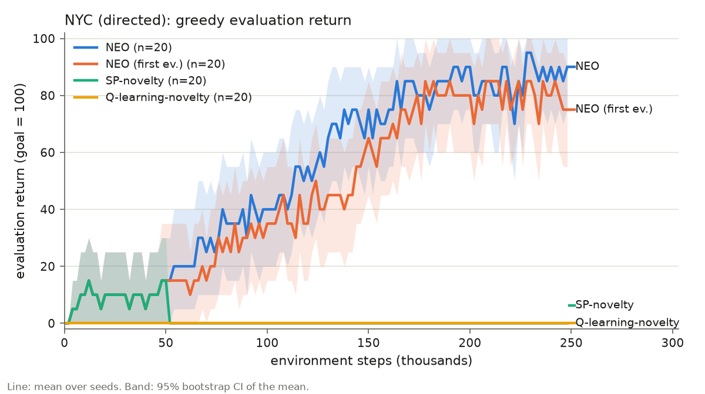
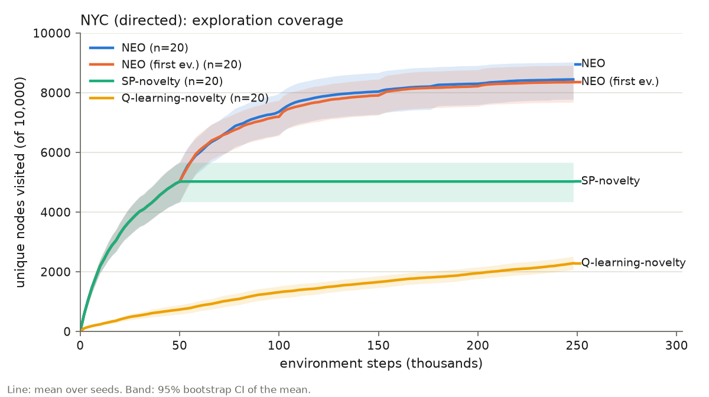

# NYC reproduction (C2) and NEO-first-eigenvector (C3): first results

Meeting with Lucia, 10 Nov 2026. Full numbers are in [summary.md](summary.md), and every change from the original code is in [DEVIATIONS.md](../../DEVIATIONS.md).

## Setup
- **Graph:** NYC street graph downloaded once with the paper's settings and stored in `data/nyc/` (`nyc_graph.py`). It has 10,000 nodes and 22,322 edges; the paper reports 22,354. 98.8 % of the nodes form one strongly connected component, and 33 nodes are dead ends.
- **Code:** the authors' training loop is unchanged. We added a per-run script (`run_nyc.py`), seeded NumPy, and pinned the environment (`requirements.txt`).
- **Runs:** 20 seeds × 4 methods, 250k steps each, with a greedy evaluation every 2k steps. One run takes about 2 minutes on a laptop (peak 5.3 GB RAM), so **we do not need course compute.**

## Results

| | AUC (mean eval return) [95 % CI] | final return | seeds that ever reach the goal | final coverage (nodes) |
|---|---|---|---|---|
| NEO | 52.2 [41.4, 62.9] | 88.5 | 19/20 | 8444 |
| NEO (first ev.) | 45.5 [34.4, 56.7] | 79.5 | 19/20 | 8354 |
| SP-novelty | 1.8 [0.0, 4.4] | 0.0 | 4/20 | 5024 |
| Q-learning-novelty | 0.0 | 0.0 | 0/20 | 2284 |

- **C2 reproduces qualitatively.** NEO beats both baselines by a wide margin (paired Wilcoxon on AUC, p = 1.3e-4 for each).
- **C3: no significant benefit from 4 eigenvectors over 1 on NYC.** The AUC difference is +6.7 (p = 0.33), and the coverage curves are almost identical.

## Caveats we found
1. **Only 3 distinct tasks.** The code picks a random start and sets the goal to the farthest reachable node. Over the 20 seeds this gives only three goals (node 7367 for 13 seeds, 2181 for 4, 5024 for 3), so the "20 instances" are not 20 independent tasks. The paper's text describes a different rule: a random goal, with the start placed farthest from it.
2. **The SP-novelty baseline is probably handicapped by a code detail.** Reaching a dead end ends the episode *before* the dead end's visit count is incremented, so all 33 dead ends stay at count 0 ("most novel") for the whole run. After the first option update (50k steps), SP's coverage freezes completely in all 20 seeds, and SP runs about 6,800 episodes per run against about 320 for NEO. This strongly suggests its options keep driving the agent into dead ends. To confirm it, we still need to log the option targets.
3. **The Q-learning-novelty baseline is pessimistic.** The bonus 0.01/√n(s,a) is added to actions that were *already taken*, while untried actions keep Q = 0. Greedy action choice therefore prefers known actions. As a result its coverage is far below plain ε-greedy Q-learning (compare the curves over 0–50k steps, before any options exist).
4. **Few option updates.** With H = 5 × #nodes = 50k steps, NEO recomputes its options only 4 times per run. NEO-1 therefore ends up with 4 options in total, against 16 for NEO.

## Links to the theory (C1)
- **Eigenvalues.** All 320 NEO eigenvalues have Re λ < δ = 0.5 (range 0.452–0.481). 8 of them have a tiny imaginary part (|Im| ≤ 1e-3), whereas the paper reports none.
- **Eigenvector is zero on the sources** (seed 0, first update; `theory/check_frontier_zero.py`). All 12 never-visited nodes (ζ = 0, the theory's "sources") have no observed out-edge, so their row of P is zero and **the eigenvector is exactly 0 there**. The maximum of |f| sits on nodes visited once. Thm 3.2 ("the maximum is at a source") therefore does not apply in practice, because its row-stochastic assumption fails. Thm 3.3's guarantee still held: a greedy ascent from the most-visited node ended at a node with ζ < Re λ.

## Eigen-options (S1, early observation)
On our 48 GB machine, seed 0 did **not** crash. The first three option updates completed, and the polar decomposition finished each time. At the fourth update (200k steps) the run has been inside ARPACK (`eigs(which='SR')`) for more than 10 minutes. Our lead is that the "solver crash" is ARPACK not converging, rather than an instability of the polar decomposition.

## Questions for Lucia
1. **Start/goal protocol.** Should we keep the code's rule (which gave Fig. 3k), switch to the paper's rule, or report both?
2. **Baseline fairness.** Can we add a separate "fixed baselines" experiment (count dead ends; optimistic Q-learning-novelty) next to the as-published reproduction?
3. **C3 power.** Runs are cheap. Should we use more seeds or goals, and should we vary the number of eigenvectors Z ∈ {1, 2, 4, 8} or the option-update period?
4. **S1 scope.** Given the ARPACK lead, is a short diagnosis enough (shift-invert vs. `which='SR'`, convergence vs. graph connectivity)?
